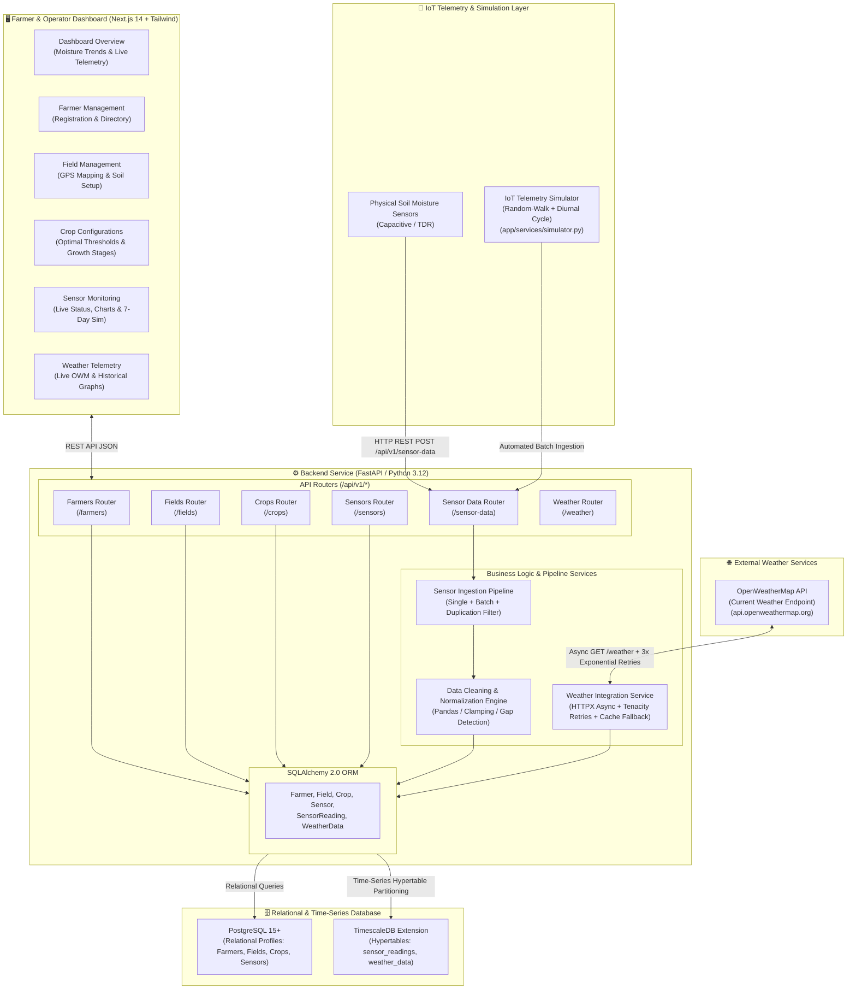

# 🏛️ System Architecture — Milestone 1

## AI-Powered Smart Irrigation System for Predictive Water Management and Crop Optimization
**Milestone 1: Sensor Data Ingestion & Weather API Integration (Weeks 1–2)**

---

## 1. High-Level System Architecture Diagram

---

## 2. Architectural Design Decisions

### 2.1 Backend: FastAPI + Pydantic + SQLAlchemy
- **FastAPI**: Selected for native asynchronous execution, automatic interactive OpenAPI/Swagger generation (`/docs`), and native type checking.
- **Pydantic v2**: Enforces strict payload validation at the gateway level. Sensor values outside physiological or physical possibilities (e.g. soil moisture < 0% or > 100%) are rejected or flagged before hitting database storage.
- **SQLAlchemy 2.0**: Type-safe Object Relational Mapping (ORM) allowing seamless transition between PostgreSQL with TimescaleDB in production and SQLite in isolated automated test environments.

### 2.2 Time-Series Engine: TimescaleDB Hypertables
- Regular relational databases degrade exponentially when millions of time-indexed sensor readings are accumulated.
- **TimescaleDB** partitions data by time intervals (e.g., 1-day chunks) under the hood while maintaining standard SQL table semantics.
- Querying the last 24 hours of soil moisture across 500 fields runs orders of magnitude faster without manual table partitioning.

### 2.3 Sensor Telemetry Simulation Engine
- Physical IoT hardware is frequently unavailable during early development phases.
- The simulator (`app/services/simulator.py`) generates realistic diurnal cycles:
  - Soil moisture decreases slowly during daylight hours due to evapotranspiration and stabilizes at night.
  - Temperature peaks in the early afternoon (14:00) and bottoms out before dawn (05:00).
  - Explicit provenance tracking: every simulated record carries `is_simulated = True` and `quality_flag = 'SIMULATED'`.

### 2.4 External Weather Resilience: Exponential Backoff & Cached Fallback
- Third-party weather APIs (OpenWeatherMap) can experience transient outages, rate limiting, or network timeouts.
- Using `tenacity`, the weather client retries failed attempts up to 3 times with exponential backoff (1s, 2s, 4s).
- If all attempts fail, the service returns the most recent cached observation for the field with an explicit `is_stale = True` metadata flag, preventing system crashes.

