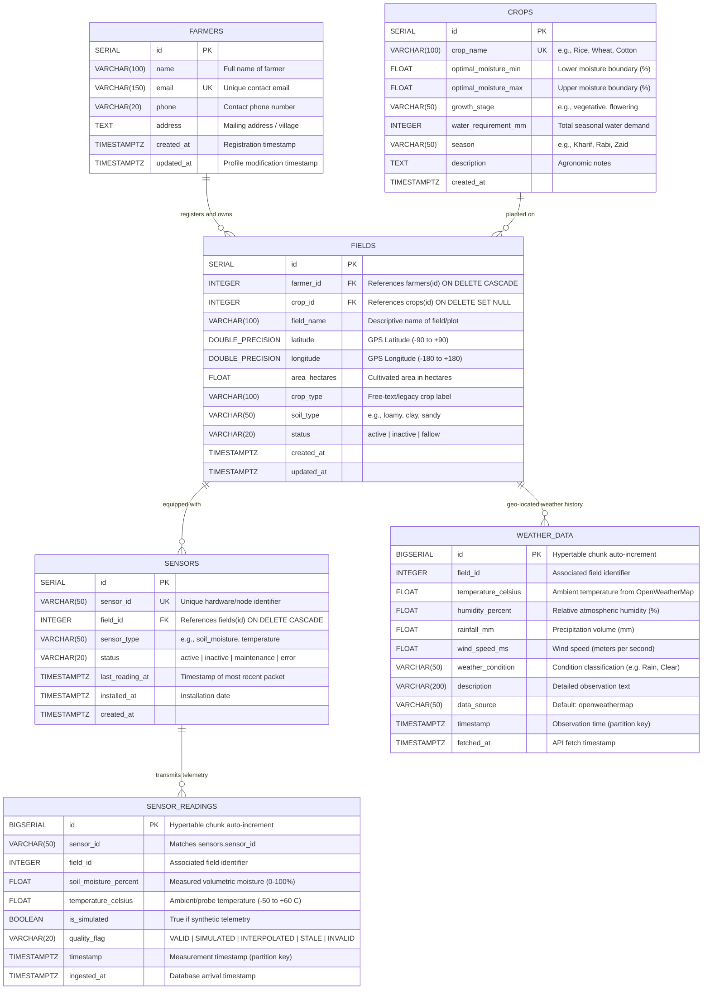

# 🗄️ Database Entity-Relationship (ER) Diagram

## AI-Powered Smart Irrigation System
**Database Stack**: PostgreSQL 15+ with TimescaleDB Hypertable Extensions

---

## 1. Mermaid Entity-Relationship Diagram

---

## 2. Table Specifications & Indexes

| Table | Storage Engine | Partition Interval | Foreign Keys | Key Indexes |
|---|---|---|---|---|
| `farmers` | PostgreSQL Relational | N/A | None | `email` (UNIQUE) |
| `crops` | PostgreSQL Relational | N/A | None | `crop_name` (UNIQUE) |
| `fields` | PostgreSQL Relational | N/A | `farmer_id`, `crop_id` | `farmer_id`, `crop_id` |
| `sensors` | PostgreSQL Relational | N/A | `field_id` | `sensor_id` (UNIQUE), `field_id` |
| `sensor_readings` | **TimescaleDB Hypertable** | **1 day** | Denormalized for partition performance | `(sensor_id, timestamp DESC)`, `(field_id, timestamp DESC)` |
| `weather_data` | **TimescaleDB Hypertable** | **1 day** | Denormalized for partition performance | `(field_id, timestamp DESC)` |

---

## 3. Data Integrity & Validation Rules

1. **Cascade Semantics**:
   - Deleting a `farmer` cascades to all owned `fields` and attached `sensors`.
   - Deleting a `crop` sets `fields.crop_id` to `NULL`, preserving the field configuration.
2. **Quality Provenance**:
   - `quality_flag` enforces explicit classification:
     - `VALID`: Physical reading within physical bounds.
     - `SIMULATED`: Generated by the sensor telemetry simulation service.
     - `INTERPOLATED`: Cleaned or filled by pandas batch routines.
     - `STALE`: Cached weather observation returned after API downtime.
     - `INVALID`: Rejected sensor value (e.g. moisture > 100% or sensor failure).

